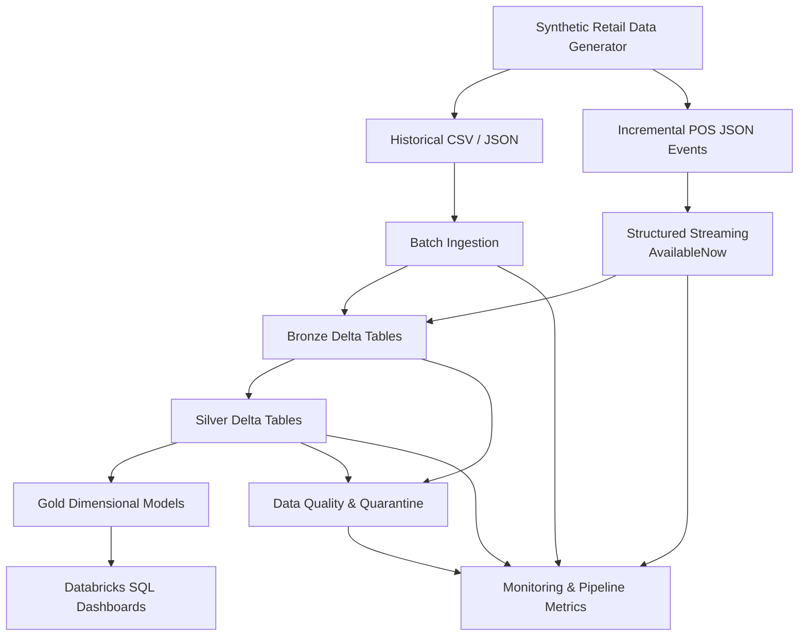
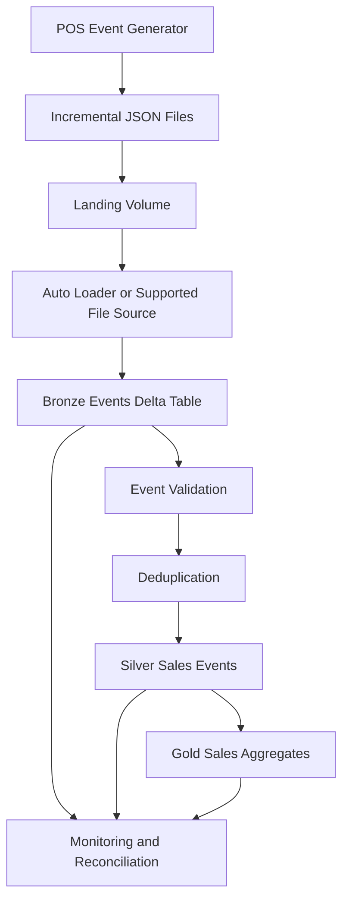

# RetailPulse — System Architecture

**Project:** RetailPulse
**Version:** 1.0
**Status:** Proposed architecture
**Architecture style:** Lakehouse / Medallion Architecture
**Platform:** Databricks Free Edition

## 1. Architecture Overview

RetailPulse is designed as a modular Lakehouse data platform for a simulated Moroccan supermarket chain.

The architecture integrates historical and incremental retail data, applies distributed transformations, enforces data quality and produces analytical datasets for business intelligence.

The solution follows three main architectural principles:

1. Separation of ingestion, transformation and consumption.
2. Preservation of raw data and traceability throughout processing.
3. Reproducible and idempotent data processing.

The platform combines local development tools with Databricks-managed execution.

## 2. High-Level Architecture

The platform consists of six logical layers:

| Layer | Components | Responsibility |
|---|---|---|
| Source | Synthetic retail datasets and POS events | Generate operational data |
| Ingestion | Python, Spark batch, Auto Loader | Load historical and incremental data |
| Storage | Unity Catalog, Delta Lake | Persist and organize data |
| Processing | PySpark, Spark SQL | Transform and integrate records |
| Quality and monitoring | Validation, quarantine, monitoring tables | Ensure reliability |
| Consumption | Gold tables, SQL dashboards | Deliver business insights |

### Main architecture flow



## 3. Development and Execution Architecture

### 3.1 Local Development

The developer environment runs on macOS using VS Code and Python 3.12.

Responsibilities:

- Generate deterministic synthetic data.
- Develop reusable Python modules.
- Implement validation and transformation logic.
- Run unit tests with pytest.
- Perform static analysis with Ruff.
- Maintain project documentation.
- Version code using Git and GitHub.

The local environment is independent of Databricks for basic development and unit testing.

### 3.2 Databricks Execution

Databricks provides managed Spark execution and Delta Lake storage.

Responsibilities:

- Execute distributed batch processing.
- Execute incremental streaming workloads.
- Persist Delta tables.
- Apply transformations and data quality rules.
- Build analytical models.
- Orchestrate processing workflows.
- Expose analytical datasets.

The initial implementation targets serverless compute in Databricks Free Edition.

### 3.3 Environment Separation

Three logical environments are defined:

**Local development**
- Source code.
- Synthetic data generation.
- Unit testing.
- Static analysis.

**Databricks development**
- Experimental processing.
- Integration tests.
- Development Delta tables.

**Databricks production-like**
- Reproducible end-to-end execution.
- Validated Gold outputs.
- Demonstration dashboards.

The production-like environment is a logical deployment stage, not a separate paid workspace requirement.

## 4. Source Data Architecture

The data generator simulates a supermarket chain operating across five Moroccan cities.

Source entities:

| Entity | Description | Expected format |
|---|---|---|
| Stores | Store locations and attributes | CSV / JSON |
| Products | Product catalog | CSV / JSON |
| Customers | Synthetic customer profiles | CSV / JSON |
| Suppliers | Supplier information | CSV / JSON |
| Sales | Historical transaction lines | CSV / JSON |
| Inventory | Historical stock observations | CSV / JSON |
| Purchase orders | Procurement records | CSV / JSON |
| POS events | Incremental transaction events | JSON |

Generated data must include stable identifiers, documented schemas and reproducible business rules.

## 5. Batch Ingestion Architecture

Batch processing handles historical datasets.

### Processing flow

1. Generate historical source datasets.
2. Validate source availability.
3. Read source files.
4. Apply schema validation.
5. Add ingestion metadata.
6. Write raw records into Bronze.
7. Execute Silver transformations.
8. Apply quality controls.
9. Build Gold analytical tables.
10. Record processing metrics.

### Batch ingestion characteristics

- Historical and incremental batch support.
- Explicit schemas.
- Source lineage.
- Record-count reconciliation.
- Controlled error handling.
- Idempotent curated writes.
- Reproducible execution.

Batch processing must not rely on arbitrary full-table replacement when incremental business history needs to be preserved.

## 6. Streaming Ingestion Architecture

The streaming component simulates incoming POS transactions using incremental JSON files.

### Streaming flow



### Execution model

The initial implementation uses Spark Structured Streaming with `Trigger.AvailableNow()`.

Each execution processes newly available files and terminates after the available input has been consumed.

Repeated executions simulate continuous business activity through incremental micro-batches.

### Streaming controls

- Stable event identifiers.
- Event timestamps.
- Ingestion timestamps.
- Checkpoint management.
- Schema management.
- Duplicate detection.
- Late-event handling.
- Idempotent downstream processing.

The design does not assume a permanently running streaming consumer.

## 7. Medallion Storage Architecture

### 7.1 Bronze Layer

**Purpose:** Preserve source records and ingestion lineage.

Responsibilities:

- Store original source attributes.
- Record source file information.
- Record ingestion timestamps.
- Track processing runs.
- Preserve raw event history.
- Support reprocessing.

Example datasets:

- `bronze.sales`
- `bronze.inventory`
- `bronze.products`
- `bronze.customers`
- `bronze.suppliers`
- `bronze.stores`
- `bronze.purchase_orders`
- `bronze.pos_events`

### 7.2 Silver Layer

**Purpose:** Produce trusted and standardized business datasets.

Responsibilities:

- Normalize data types.
- Standardize timestamps.
- Standardize monetary values.
- Deduplicate records.
- Validate business rules.
- Resolve relationships.
- Handle invalid records.
- Maintain historical changes where applicable.

Example datasets:

- `silver.sales`
- `silver.inventory`
- `silver.products`
- `silver.customers`
- `silver.suppliers`
- `silver.purchase_orders`
- `silver.pos_events`

### 7.3 Gold Layer

**Purpose:** Provide business-ready analytical models.

Dimensions:

- `gold.dim_date`
- `gold.dim_product`
- `gold.dim_customer`
- `gold.dim_store`
- `gold.dim_supplier`

Facts:

- `gold.fact_sales`
- `gold.fact_inventory_snapshot`
- `gold.fact_supplier_delivery`

Gold datasets will follow documented grains, keys and business definitions.

## 8. Data Quality Architecture

Data quality is applied at multiple stages.

### Bronze validation

- Source schema availability.
- Required ingestion metadata.
- File processing integrity.

### Silver validation

- Completeness.
- Uniqueness.
- Validity.
- Referential integrity.
- Business-rule consistency.
- Event-time validity.

### Gold validation

- Fact and dimension relationships.
- Grain uniqueness.
- KPI reconciliation.
- Aggregate consistency.

Invalid records will be directed to quarantine datasets with associated rejection reasons.

The quality framework must distinguish between:

- Fatal pipeline errors.
- Invalid business records.
- Non-blocking warnings.

## 9. Monitoring Architecture

Monitoring is a cross-cutting component.

Proposed monitoring datasets:

| Dataset | Purpose |
|---|---|
| `monitoring.pipeline_runs` | Pipeline execution history |
| `monitoring.data_quality_results` | Quality validation results |
| `monitoring.rejected_records` | Invalid records and reasons |
| `monitoring.ingestion_metrics` | Source and processing metrics |

Metrics include:

- Execution duration.
- Input record count.
- Output record count.
- Rejected record count.
- Pipeline status.
- Data freshness.
- Processing volume.

Monitoring data should enable troubleshooting and operational analysis.

## 10. Data Consumption Architecture

The Gold layer serves four analytical domains.

### Sales Analytics

- Net revenue.
- Transaction count.
- Average basket value.
- Sales growth.
- Product and store performance.

### Inventory Analytics

- Stock availability.
- Stockout rate.
- Inventory turnover.
- Days of inventory.
- Inventory valuation.

### Supplier Analytics

- On-time delivery rate.
- Average lead time.
- Purchase order fulfillment.
- Supplier comparisons.

### Customer Analytics

- RFM segmentation.
- Purchase frequency.
- Retention.
- Estimated customer lifetime value.

Databricks SQL dashboards will be the initial analytical interface.

## 11. Logical Data Organization

The initial target namespace is a configurable development catalog.

Proposed schemas:

- `bronze`
- `silver`
- `gold`
- `monitoring`

A Unity Catalog Volume named `landing` will hold non-tabular source files and supporting ingestion metadata where supported.

Logical organization:

```text
<development_catalog>
│
├── bronze
├── silver
├── gold
├── monitoring
│
└── landing (Volume)
    ├── batch/
    ├── streaming/
    └── checkpoints/
```

The actual catalog name, Volume privileges and storage paths must be verified before deployment.

Streaming checkpoints and Auto Loader schema metadata should use dedicated, persistent locations. They must not be mixed with source files or Delta table directories.

## 12. Orchestration Architecture

Databricks Lakeflow Jobs is the preferred orchestration mechanism, subject to Free Edition availability.

The logical workflow contains:

1. Historical ingestion.
2. Bronze validation.
3. Silver transformations.
4. Data quality execution.
5. Gold modeling.
6. Streaming ingestion.
7. Reconciliation and monitoring.

The first implementation will favor sequential, independently testable tasks.

Concurrency and pipeline execution must respect the available workspace quotas.

## 13. Failure Handling and Recovery

### Source ingestion failure

- Record the failure.
- Preserve source files.
- Avoid publishing incomplete curated outputs.
- Allow controlled reprocessing.

### Transformation failure

- Record the failing stage.
- Preserve previously committed Delta data.
- Prevent downstream publication of incomplete results.
- Support safe reruns.

### Streaming interruption

- Retain checkpoint state.
- Resume from a valid checkpoint.
- Validate duplicate handling.
- Reconcile processed event counts.

### Data quality failure

- Quarantine invalid records.
- Record validation reasons.
- Continue processing valid records when business rules permit.

## 14. Data Lineage

Every dataset should maintain sufficient metadata to trace its origin and processing history.

Proposed metadata:

- `source_system`
- `source_file`
- `ingestion_timestamp`
- `pipeline_run_id`
- `record_created_timestamp`
- `record_updated_timestamp`

The implementation will establish traceability from source files through Bronze, Silver and Gold.

## 15. Security and Governance

Unity Catalog will provide the logical governance layer.

Security requirements:

- Use managed tables where appropriate.
- Use Unity Catalog Volumes for file storage.
- Keep credentials out of GitHub.
- Use synthetic customer information.
- Apply least-privilege access where supported.
- Separate configuration from business logic.

## 16. Architecture Decisions

| ID | Decision | Rationale |
|---|---|---|
| ADR-01 | Adopt Medallion Architecture | Clear separation of data refinement stages |
| ADR-02 | Use Delta Lake | Reliable transactional table storage |
| ADR-03 | Separate batch and streaming ingestion | Different processing requirements |
| ADR-04 | Use file-based streaming simulation | Compatible with the initial environment |
| ADR-05 | Use AvailableNow micro-batches | Fits serverless execution constraints |
| ADR-06 | Use Unity Catalog | Governance and managed storage |
| ADR-07 | Keep local development independent | Reproducibility and testability |
| ADR-08 | Implement business-level idempotency | Safe reprocessing |
| ADR-09 | Centralize monitoring datasets | Operational visibility |
| ADR-10 | Use a star schema for Gold | Business-oriented analytics |

## 17. Architecture Acceptance Criteria

The architecture is accepted when:

1. Source systems and data flows are documented.
2. Local and cloud execution responsibilities are defined.
3. Batch and streaming flows are specified.
4. Medallion layer responsibilities are clear.
5. Storage organization is defined.
6. Quality and monitoring mechanisms are documented.
7. Failure and recovery strategies are specified.
8. Data lineage requirements are defined.
9. Architecture decisions are recorded.
10. Databricks-specific capabilities are verified before implementation.

## 18. Future Architectural Extensions

Potential future enhancements:

- Kafka-based event ingestion.
- Advanced real-time event processing.
- Demand forecasting.
- Automated stock replenishment.
- Anomaly detection.
- Advanced data observability.
- CI/CD deployment automation.
- Multi-environment deployment.
- Power BI integration.

These extensions are not required for the initial Free Edition implementation.
